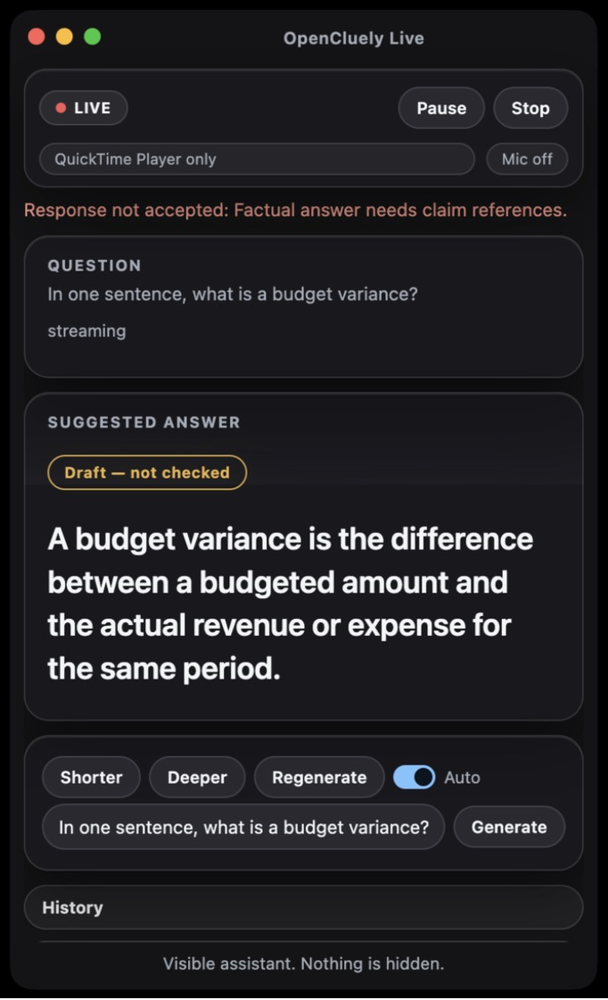
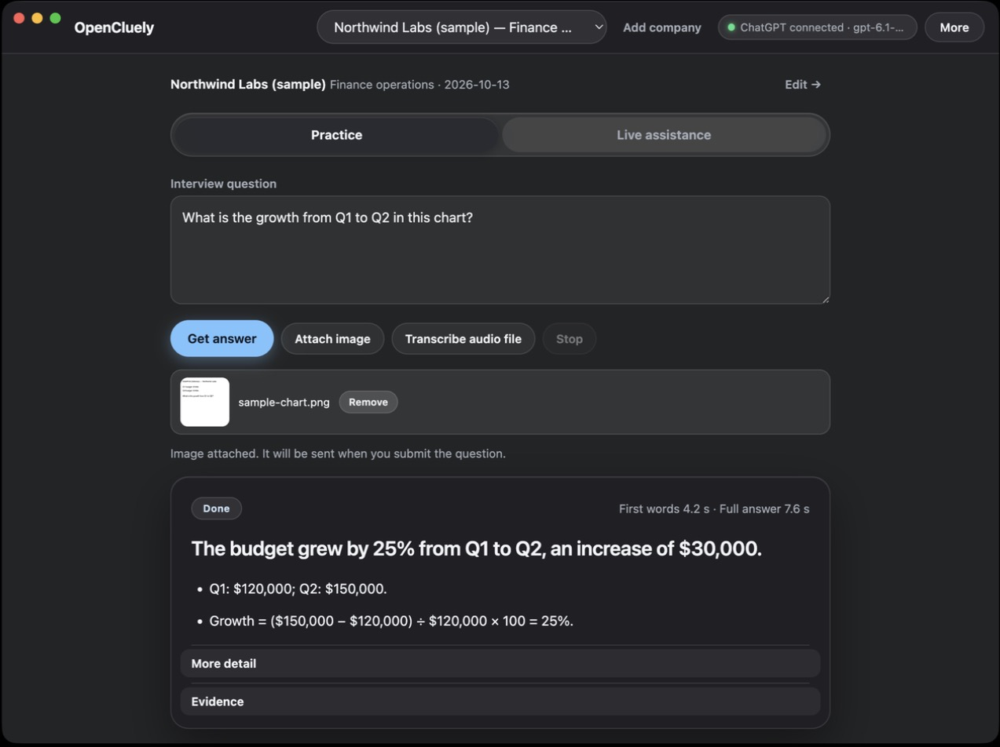
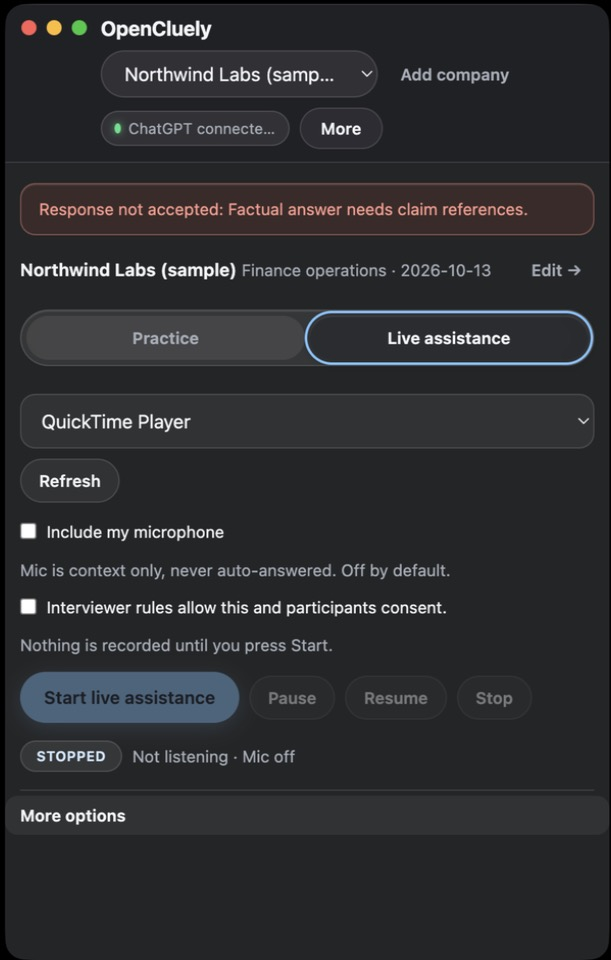

# OpenCluely · Interview Prep

A visible, consent-first interview practice tool with optional permitted
live assistance, built on top of [OpenCluely](https://github.com/TechyCSR/OpenCluely).

**This is not a stealth or cheating tool.** There is no screen-share-invisible
overlay and no hidden capture: live assistance is opt-in, requires explicit
consent, and always shows a visible recording indicator while audio capture
is active.

## What it is

- A workspace for building interview-ready "experience cards" (projects,
  internships, tools you've built) with evidence and honestly-tracked gaps.
- Per-company "briefs" (job description, notes, resume excerpt, hypotheses)
  kept isolated from each other.
- Grounded answer drafting: the model is asked for a short opening, up to
  three talking points, and an evidence trail; claims without supporting
  evidence are rejected (`prep/engine.js`).
- A practice mode with local + model-based critique.
- Optional **permitted live assistance**: with consent, the app transcribes
  meeting/system audio (and optionally your mic) locally and surfaces a
  question + grounded answer in an overlay, with visible Pause/Resume/Stop
  controls at all times.

## Screenshots

| | | |
|---|---|---|
|  |  |  |

(Screenshots show only fictional sample data — "Northwind Labs (sample)" —
not real company or personal information.)

## Requirements

- macOS 13+ on Apple Silicon (tested platform; other OpenCluely platforms
  may work but are not verified for the interview-prep features in this
  fork).
- Node.js 22+.
- Python 3 + local [OpenAI Whisper](https://github.com/openai/whisper)
  (optional, for local transcription — `./setup.sh` can set this up).

## Quick start

```bash
git clone https://github.com/zayyanla-hash/opencluely-interview-prep
cd opencluely-interview-prep
npm install
./scripts/setup-chatgpt-sdk.sh   # optional: only needed for ChatGPT sign-in
npm start                         # or: ./Launch.command
```

`./setup.sh` is also available and will create `.env` from `env.example`,
install dependencies, and optionally set up local Whisper.

## ChatGPT sign-in

ChatGPT support uses OpenAI's official "Sign in with ChatGPT Devkit." Each
user signs in with **their own** ChatGPT account through that SDK's own
OAuth flow — no API keys or credentials are shipped with this repository.
The devkit is **not vendored** in this repo (it's under a noncommercial
license, separate from this repo's license — see below); run
`./scripts/setup-chatgpt-sdk.sh` to fetch, patch, and build it locally. See
[`patches/README.md`](patches/README.md) for details on the one small
local patch applied to it.

### Local model alternative

You don't need ChatGPT sign-in at all: set `AI_PROVIDER=local` in `.env`
(see [`env.example`](env.example)) and point `LOCAL_LLM_URL` at any
OpenAI-compatible local server (e.g. llama.cpp, MLX, LM Studio).

## Privacy

- Nothing is sent anywhere until you ask a question or start live mode.
- Live audio capture requires explicit, separate consent and shows a
  persistent recording indicator; no screen content is ever captured.
- The model receives a compact summary: your candidate profile summary, up
  to three relevant experience cards, excerpts from the current company's
  brief, your question, and a few recent practice turns for that company —
  not your whole profile or resume history.
- Company notes, job descriptions, and resume text are treated as
  **untrusted data**, never as instructions (see the injection-resistance
  tests in `tests/interview-prep.test.js`).
- Everything is stored locally: under `.app-data/interview-prep` in a
  source checkout, or the OS `userData` folder in a packaged build. Nothing
  is synced to any server by this app itself.
- See [`docs/interview-prep-guide.md`](docs/interview-prep-guide.md) for
  the full privacy and permitted-assistance walkthrough.

## Tests

```bash
npm test
```

Runs `node --test tests/*.test.js`. The suite does not require the ChatGPT
SDK (`@siwc/local`) to be installed.

## Limitations

- Builds are unsigned/un-notarized; run from source (`npm start` /
  `Launch.command`) rather than relying on a packaged release.
- Real-world use against Zoom/Google Meet has not been fully qualified;
  the native audio helper and live pipeline are unit/self-tested but not
  exhaustively verified against every meeting app and OS permission state.
  See the manual QA checklist in
  [`docs/realtime-implementation.md`](docs/realtime-implementation.md).

## Credits

This is a fork of [OpenCluely](https://github.com/TechyCSR/OpenCluely) by
[TechyCSR](https://github.com/TechyCSR), adapted into an interview-practice
and permitted-assistance workspace. See
[`docs/upstream-readme.md`](docs/upstream-readme.md) for the original
project's README.

## License

This repository's own code is licensed under **Apache-2.0** (see
[`LICENSE`](LICENSE)), the same as upstream OpenCluely.

OpenAI's Sign in with ChatGPT Devkit, which this app can optionally use for
ChatGPT sign-in, is **not** part of this repository and is licensed
separately under its own **noncommercial** license — see
[`patches/README.md`](patches/README.md) and the devkit's own `LICENSE`
once fetched by `scripts/setup-chatgpt-sdk.sh`.
